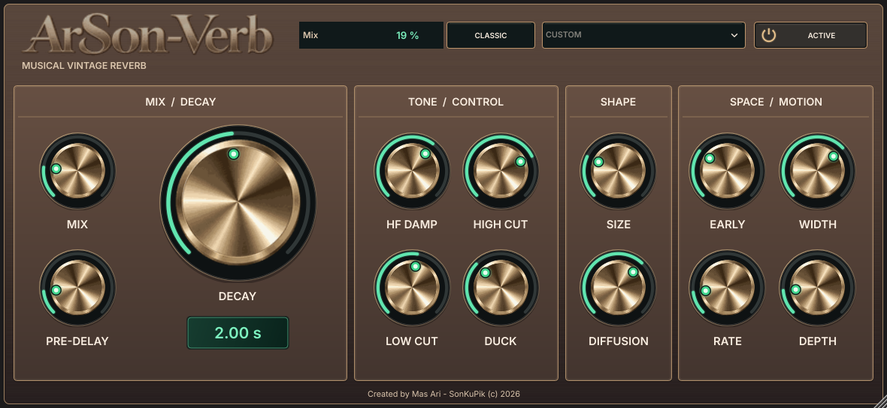

# ArSonVerb

**Musical, vintage-inspired algorithmic reverb — free and open source.**

[](https://github.com/masarray/arsonverb/actions/workflows/deploy-pages.yml)
[](https://github.com/masarray/arsonverb/actions/workflows/core-ci.yml)
[](LICENSE)
[](https://github.com/masarray/arsonverb/releases/tag/v1.0.1)

**[Website & downloads](https://masarray.github.io/arsonverb/)** · **[Get v1.0.1](https://github.com/masarray/arsonverb/releases/tag/v1.0.1)** · [Installation](docs/RELEASE_V1.0.1.md) · [Report a problem](https://github.com/masarray/arsonverb/issues/new/choose)



ArSonVerb is an original C++17 reverb designed for vocals, instruments and live or studio mixes. It combines an efficient real-time DSP core with a JUCE 9 VST3 plug-in and standalone application. No account, subscription, or paid licence is needed.

## Download and install

Choose the **VST3-only package** to use ArSonVerb inside a compatible DAW. The Windows Installer ZIP is optional and includes Inno Setup with selectable VST3 and Standalone components.

| Platform | VST3-only (recommended) | Standalone | Installer |
|---|---|---|---|
| **Windows x64** | [Download ZIP](https://github.com/masarray/arsonverb/releases/download/v1.0.1/ArSonVerb-Windows-x64-VST3-v1.0.1.zip) | [Portable ZIP](https://github.com/masarray/arsonverb/releases/download/v1.0.1/ArSonVerb-Windows-x64-Standalone-v1.0.1.zip) | [Installer in ZIP](https://github.com/masarray/arsonverb/releases/download/v1.0.1/ArSonVerb-Windows-x64-Installer-v1.0.1.zip) |
| **macOS** (Intel / Apple Silicon) | [Universal ZIP](https://github.com/masarray/arsonverb/releases/download/v1.0.1/ArSonVerb-macOS-universal-VST3-v1.0.1.zip) | [Universal app ZIP](https://github.com/masarray/arsonverb/releases/download/v1.0.1/ArSonVerb-macOS-universal-Standalone-v1.0.1.zip) | Manual installation |
| **Linux x86_64** | [VST3 tar.gz](https://github.com/masarray/arsonverb/releases/download/v1.0.1/ArSonVerb-Linux-x86_64-VST3-v1.0.1.tar.gz) | [Standalone tar.gz](https://github.com/masarray/arsonverb/releases/download/v1.0.1/ArSonVerb-Linux-x86_64-Standalone-v1.0.1.tar.gz) | Manual installation |

**Manual VST3 installation locations**

- Windows, current user: `%LOCALAPPDATA%\Programs\Common\VST3\` (system-wide: `C:\Program Files\Common Files\VST3\`)
- macOS, current user: `~/Library/Audio/Plug-Ins/VST3/`
- Linux, current user: `~/.vst3/`

Extract the complete `ArSonVerb.vst3` bundle, copy it to your platform's VST3 location, then reopen your DAW and rescan plugins. For details, see the [release installation guide](docs/RELEASE_V1.0.1.md). macOS binaries are not Apple-notarized, Windows binaries are publisher-unsigned, and Linux desktop libraries vary by distro. Archive downloads can still be inspected by browser security services.

Verify the original seven release artifacts using [SHA256SUMS.txt](https://github.com/masarray/arsonverb/releases/download/v1.0.1/SHA256SUMS.txt), or the additional [Windows Installer ZIP checksum](https://github.com/masarray/arsonverb/releases/download/v1.0.1/SHA256SUMS-Installer-ZIP.txt).

## Designed for musical space

| Feature | What it does |
|---|---|
| **Four algorithms** | Classic, Plate, Chamber, Hall, with distinct orthogonal feedback matrices |
| **32 factory presets** | Vocal, instrument and ambient starting points |
| **13 hands-on controls** | Mix, Pre-delay, Decay, Size, Diffusion, Damping, Low/High Cut, modulation, Width, Early and Duck |
| **Mono and stereo** | Tested native 1→1, 1→2 and 2→2 JUCE host layouts |
| **Studio workflows** | Insert reverb or 100% wet aux/send return |
| **Reusable DSP core** | Portable C++ API and optional shared-library C ABI |

The engine reports **zero additional algorithmic latency** to the host; audio-driver, buffer and round-trip latency still exist. Objective DSP and JUCE-host tests do **not** prove subjective superiority, universal DAW compatibility, zero glitches on every interface, or equality with any commercial reverb.

## Build from source

The core builds without JUCE or network access (CMake 3.18+, C++17):

```bash
cmake -S . -B build -DCMAKE_BUILD_TYPE=Release -DARVERB_BUILD_TESTS=ON
cmake --build build --config Release --parallel 2
ctest --test-dir build -C Release --output-on-failure
```

For the native VST3 and standalone formats, use CMake 3.22+ and JUCE **9.0.4** (fetched from its pinned tag or provided with `ARVERB_JUCE_SOURCE_DIR`):

```bash
cmake -S . -B build-plugin -DCMAKE_BUILD_TYPE=Release -DARVERB_BUILD_PLUGIN=ON -DARVERB_BUILD_TESTS=ON
cmake --build build-plugin --config Release --parallel 2 --target ARStudioReverb_VST3 ARStudioReverb_Standalone arverb_plugin_host_tests
ctest --test-dir build-plugin -C Release --output-on-failure
```

On Windows, configure with the Visual Studio 2022 x64 generator. Install the OS-specific JUCE dependencies on Linux/macOS. See the [engineering architecture](docs/ARCHITECTURE.md), [C ABI](include/arverb/arverb_c.h) and [source](src/).

## Verification and quality

**v1.0.1 shipped from tested source.** Windows x64, Linux x86_64 and universal macOS native build jobs passed their 12/12 CTests, including real JUCE host contracts. The published packages and checksums were validated independently before release.

[Native build evidence](https://github.com/masarray/arsonverb/actions/runs/41247949265) · [Publication and SHA-256 checks](https://github.com/masarray/arsonverb/actions/runs/41248747185) · [Technical quality and remaining physical acceptance gates](docs/QUALITY_STATUS.md) · [Changelog](CHANGELOG.md)

Live multi-DAW validation, level-matched listening and audio-interface xrun/CPU evidence are tracked separately; **green CI is not a substitute for real hardware evaluation**.

## Project and community

- [Contributing](CONTRIBUTING.md) · [Report a bug](https://github.com/masarray/arsonverb/issues/new/choose) · [Support](SUPPORT.md) · [Security reports](SECURITY.md)
- [Code of conduct](CODE_OF_CONDUCT.md) · [Release licence and attribution](LICENSE-STATUS.md)
- [Website source / GitHub and Cloudflare Pages](docs/WEBSITE.md) · [Historical engineering notes](docs/STATUS.md)
- [SonKuPik creator channel](https://www.youtube.com/@sonkupik)

**Licence:** [GNU AGPL-3.0-only](LICENSE). The Inter font is separately licensed under [SIL OFL 1.1](assets/fonts/OFL.txt). See [LICENSE-STATUS.md](LICENSE-STATUS.md) for third-party notices and source obligations. ArSonVerb is an independent project, not affiliated with any commercial reverb brand.

© 2026 Mas Ari / SonKuPik.
